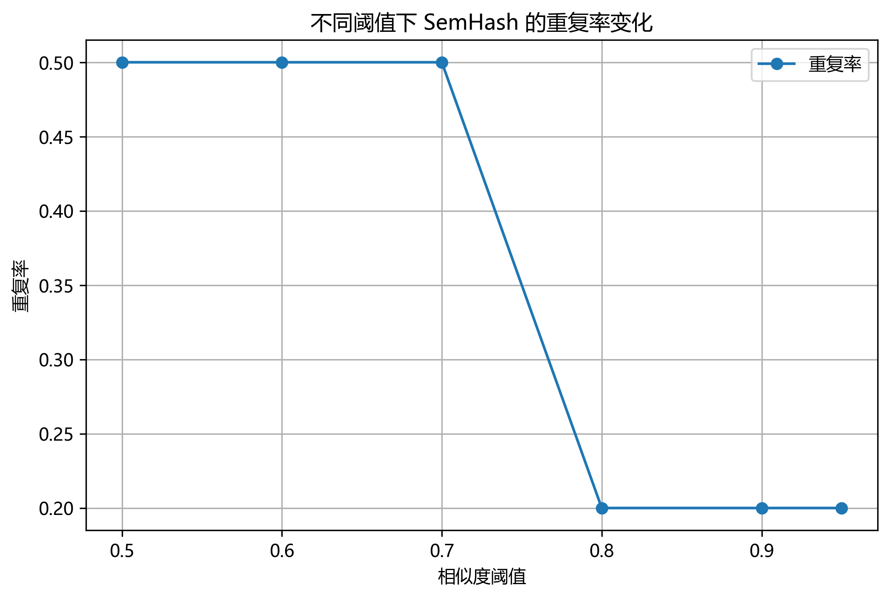
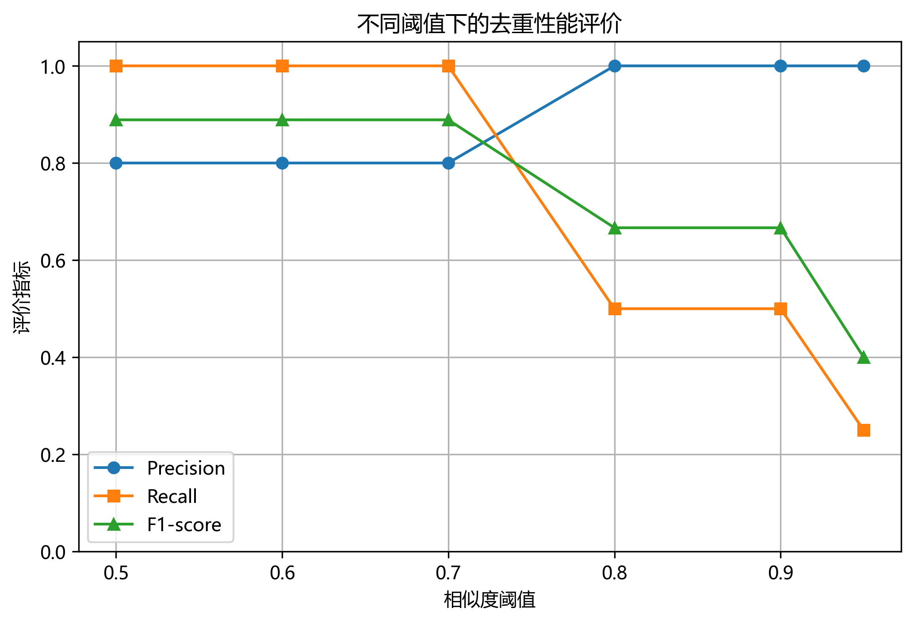
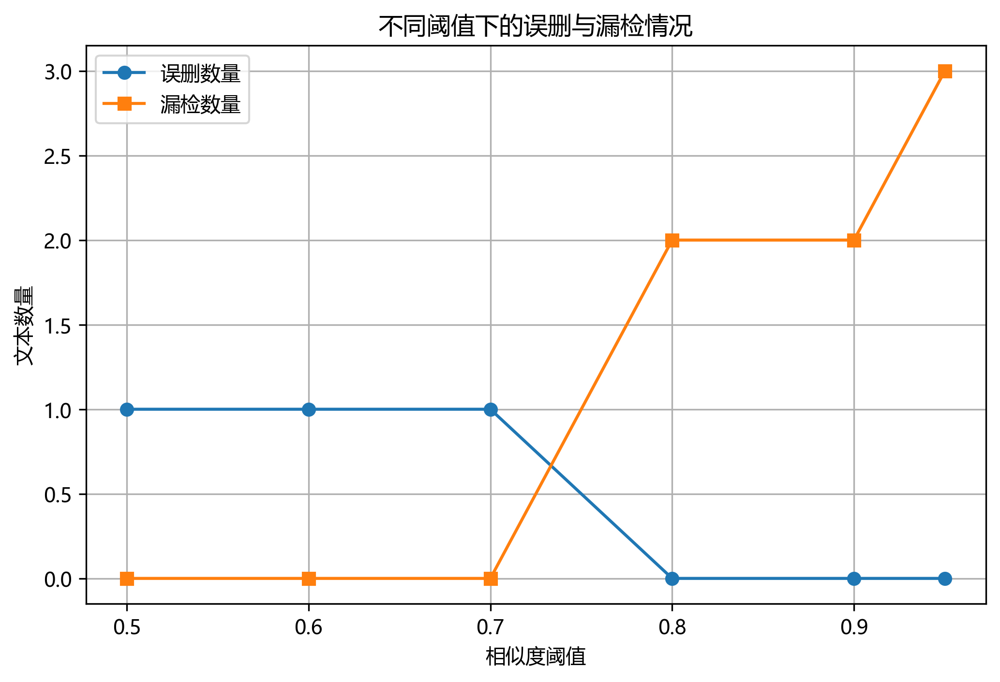

# RGB-D Multimodal Study

**A Research-Oriented Study of Multimodal Learning and Semantic Deduplication**

## 1. Project Overview

This repository records an undergraduate research project focused on multimodal learning, semantic text deduplication, and deep learning techniques.

At the current stage, the project uses **SemHash** as an entry point to explore semantic deduplication. Through source-code analysis, experimental reproduction, and comparative experiments, the project investigates text embeddings, semantic similarity, similarity thresholds, and deduplication strategies.

The longer-term research direction is to explore RGB-D multimodal learning and semantic segmentation, including the study of DFormer.

## 2. Research Objectives

- Understand the basic principles of semantic text deduplication.
- Study text embedding and semantic similarity computation.
- Analyze the influence of similarity thresholds on deduplication performance.
- Evaluate deduplication using Precision, Recall, and F1-score.
- Explore a dual-threshold strategy combining automatic filtering and manual review.
- Build a foundation for subsequent multimodal learning research.

## 3. Experimental Environment

| Component | Configuration |
|---|---|
| Operating System | Windows |
| Python | 3.10 |
| Environment Management | Conda |
| Semantic Deduplication Framework | SemHash 0.5.0 |
| Memory | 16 GB |
| GPU | No NVIDIA discrete GPU |

## 4. Experiments

### Experiment 1: Basic Semantic Deduplication

**Objective:** Understand the basic workflow of SemHash and verify that semantic duplicate texts can be identified.

The experiment uses a small collection of English sentences containing exact duplicates and semantically similar expressions.

### Experiment 2: Similarity Threshold Analysis

**Objective:** Investigate how different similarity thresholds influence the deduplication process.

The tested thresholds include:

`0.5, 0.6, 0.7, 0.8, 0.9, 0.95`

The experiment records:
- Original text count
- Selected text count
- Filtered text count
- Duplicate ratio
- Exact duplicate ratio

### Experiment 3: Evaluation on a Manually Annotated Dataset

**Objective:** Evaluate semantic deduplication performance using manually annotated duplicate texts.

Evaluation metrics:

- **Precision:** The proportion of correctly identified duplicates among all predicted duplicates.
- **Recall:** The proportion of actual duplicates successfully identified.
- **F1-score:** The harmonic mean of Precision and Recall.

Experimental results:

| Threshold | Precision | Recall | F1-score |
|---|---:|---:|---:|
| 0.5 | 0.8000 | 1.0000 | 0.8889 |
| 0.6 | 0.8000 | 1.0000 | 0.8889 |
| 0.7 | 0.8000 | 1.0000 | 0.8889 |
| 0.8 | 1.0000 | 0.5000 | 0.6667 |
| 0.9 | 1.0000 | 0.5000 | 0.6667 |
| 0.95 | 1.0000 | 0.2500 | 0.4000 |

**Observation:**

Lower thresholds identify more potential duplicates, resulting in higher recall but also some false positives. Higher thresholds improve precision but may miss semantically similar texts.

In this small test dataset, thresholds of 0.5–0.7 achieved the highest F1-score.

### Experiment 4: Dual-Threshold Semantic Deduplication

**Objective:** Introduce a dual-threshold strategy to divide candidate duplicates into different confidence levels.

Experimental parameters:

- Low threshold: 0.65
- High threshold: 0.85

The strategy divides the filtered texts into three categories:

1. High-confidence duplicates: Automatically filtered.
2. Medium-confidence duplicates: Sent for manual review.
3. Other texts: Retained.

Experimental results:

| Metric | Result |
|---|---:|
| Original texts | 10 |
| Automatically filtered | 2 |
| Manual review | 3 |
| Temporarily retained | 8 |
| True positives (automatic filtering) | 2 |
| False positives | 0 |
| False negatives | 2 |
| Precision | 1.0000 |
| Recall | 0.5000 |
| F1-score | 0.6667 |

**Observation:**

The dual-threshold strategy separates high-confidence candidates from uncertain candidates, reducing the risk of automatically deleting potentially useful texts.

The current experiment is preliminary and requires further validation on a larger dataset.

## 5. Experimental Visualizations

The following figures summarize the experimental observations.

### 5.1 Threshold and Duplicate Ratio



### 5.2 Evaluation Metrics



### 5.3 Error Analysis



## 6. Repository Structure

```text
rgb-d-multimodal-study/
│
├── docs/
│   └── Research notes and experiment documentation
│
├── results/
│   ├── experiment_02.csv
│   ├── experiment_02.json
│   ├── experiment_03.json
│   ├── experiment_03_details.csv
│   ├── experiment_03_summary.csv
│   ├── experiment_04.json
│   ├── experiment_04_details.csv
│   ├── threshold_details.csv
│   ├── threshold_experiments.json
│   ├── threshold_summary.csv
│   └── Experimental charts
│
├── semhash_demo.py
├── semhash_experiment_04.py
├── semhash_plot.py
├── README.md
└── 本科生多模态科研路线图.png
```

## 7. Current Research Progress

- [x] Configure Python and Conda environments.
- [x] Install and run SemHash.
- [x] Complete basic semantic deduplication.
- [x] Conduct similarity threshold experiments.
- [x] Evaluate results using a manually annotated dataset.
- [x] Implement a preliminary dual-threshold strategy.
- [x] Generate experimental charts.
- [x] Organize experimental data and upload it to GitHub.
- [ ] Improve the evaluation dataset and experimental methodology.
- [ ] Explore improved semantic deduplication strategies.
- [ ] Study DFormer and RGB-D multimodal semantic segmentation.

## 8. Future Research Directions

Future work will focus on the following aspects:

1. **Dataset Expansion:** Build a larger and more diverse manually annotated dataset.
2. **Threshold Optimization:** Investigate adaptive threshold selection instead of relying on fixed thresholds.
3. **Deduplication Strategy Improvement:** Explore more reliable methods for combining semantic similarity and manual review.
4. **Comparative Experiments:** Compare different embedding models and deduplication strategies.
5. **Multimodal Learning:** Gradually extend the research toward RGB-D multimodal semantic segmentation and DFormer.

## 9. Notes

This repository is an ongoing undergraduate research project. The current SemHash experiments are preliminary explorations conducted on a small manually constructed dataset. The reported results should not be interpreted as general performance benchmarks.

The purpose of this project is to develop practical research skills through source-code analysis, experimental reproduction, quantitative evaluation, and iterative improvement.

---

**Project Status:** Early-stage research and experimental exploration.

**Main Focus:** SemHash Semantic Deduplication → Improved Deduplication Strategies → RGB-D Multimodal Learning.
