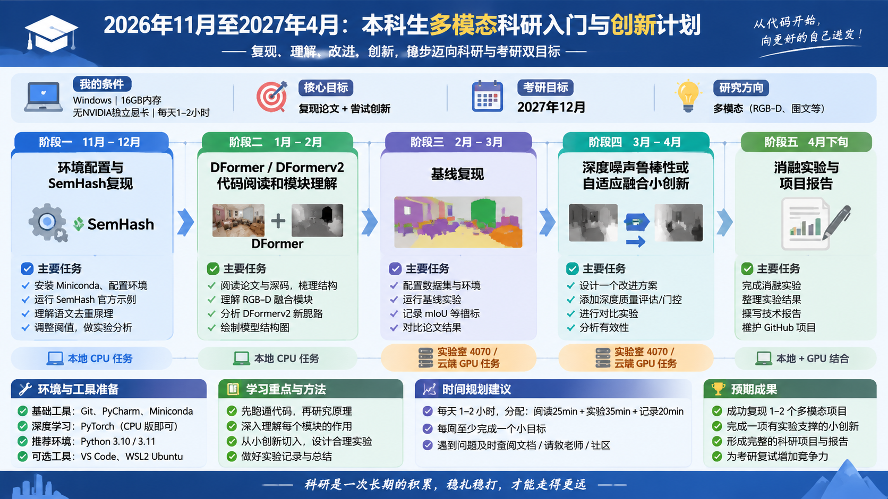

# rgb-d-multimodal-study
RGB-D multimodal segmentation study (DFormer + SemHash)

# RGB-D 多模态研究

## 1. 项目简介

本项目主要围绕多模态学习、语义去重及相关深度学习技术开展学习与实验研究。

当前阶段以 SemHash 语义文本去重工具为切入点，通过源码阅读、实验复现和对比实验，学习文本向量表示、语义相似度计算及去重策略。

## 2. 研究目标

1. 熟悉 Python 深度学习及科研实验环境。
2. 理解 SemHash 的核心模块与工作原理。
3. 掌握文本 Embedding 和语义相似度计算。
4. 研究不同相似度阈值对文本去重效果的影响。
5. 探索语义去重策略的改进方向。

## 3. 实验环境

- 操作系统：Windows
- Python：3.10
- Conda：25.11.1
- SemHash：0.5.0
- 硬件：16GB 内存，无 NVIDIA 独立显卡

## 4. 当前进度

- [x] 完成 Conda 环境配置
- [x] 创建 SemHash 独立环境
- [x] 安装 SemHash 0.5.0
- [x] 完成第一次语义去重实验
- [x] 完成精确重复与近似重复对照实验
- [ ] 阅读 SemHash 核心源码
- [ ] 开展不同阈值对比实验
- [ ] 开展不同模型对比实验
- [ ] 探索去重策略改进方法

## 5. 项目目录

- `docs/`：环境配置、复现过程与模块笔记
- `experiments/`：实验代码与结果
- `README.md`：项目介绍

## 6. 后续计划

以 SemHash 为基础，逐步开展语义去重实验，记录实验参数、评价指标及实验结果，为后续科研论文提供实验依据。

# 多模态科研学习计划

